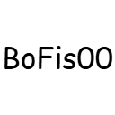

<div align="center">



# Retile

**Кисть для креатива, которая перекрашивает целые области случайными блоками по весам.**


</div>

---

## Что это

Retile — клиент-серверный мод для Fabric. Вместо того чтобы ставить блоки по одному, вы «рисуете» сферу или цилиндр: каждый блок выбирается из вашей палитры по весам, а режим «хаос» позволяет держать одинаковый блок на слое или в колонне, чтобы текстура выглядела естественно.

## Возможности

- 🎨 **Палитра с весами** — до 64 блоков, вес 1–100, детерминированный выбор по seed
- 🔵 **Формы** — сфера или цилиндр, радиус 1–32, ограничение по Y
- 🌪 **Хаос** — `0` независимый выбор, `1` один блок на слой Y, `-1` один на колонну X/Z
- ✨ **Живые контуры** — видно, какие блоки изменит следующее нажатие
- 🖌 **Мазки** — зажмите ЛКМ и ведите прицелом; один мазок = один шаг истории
- ↩️ **Отмена / повтор** — на игрока, до 30 шагов и 500 000 блоков, свои хоткеи
- 💾 **Пресеты** — сохранение палитры с весами, до 32 штук

## Установка

1. Установите **Fabric Loader 0.19.5+** для Minecraft **1.21.11** и **Fabric API**.
2. Положите `Retile-1.0.0.jar` в `mods` **и клиента, и сервера**.
3. Нужна **Java 21+**. Мод работает только в креативе.

## Как пользоваться

| Действие | Что делает |
| --- | --- |
| Деревянный топор в руке | Активирует кисть |
| ПКМ по блоку / воздуху | Открыть настройки |
| ЛКМ | Применить один раз |
| Зажать ЛКМ + движение | Рисовать мазок |
| Esc | Сохранить и закрыть |

В настройках: вкладка **«Заменители»** — палитра и веса, **«Заменяемые»** — фильтр блоков, **«Пресеты»** — сохранённые палитры.

## Сборка

```bash
./gradlew build      # Windows: gradlew.bat build
```

Готовый мод появится в `build/libs/`. Тесты запускаются вместе со сборкой.

## Ограничения

- Блоки с block entity и жидкости не поддерживаются
- Блоки ставятся в состоянии по умолчанию
- Незагруженные чанки не подгружаются
- Лимит одного мазка — 500 000 блоков

## Лицензия

CC0-1.0 — берите и делайте что хотите.
